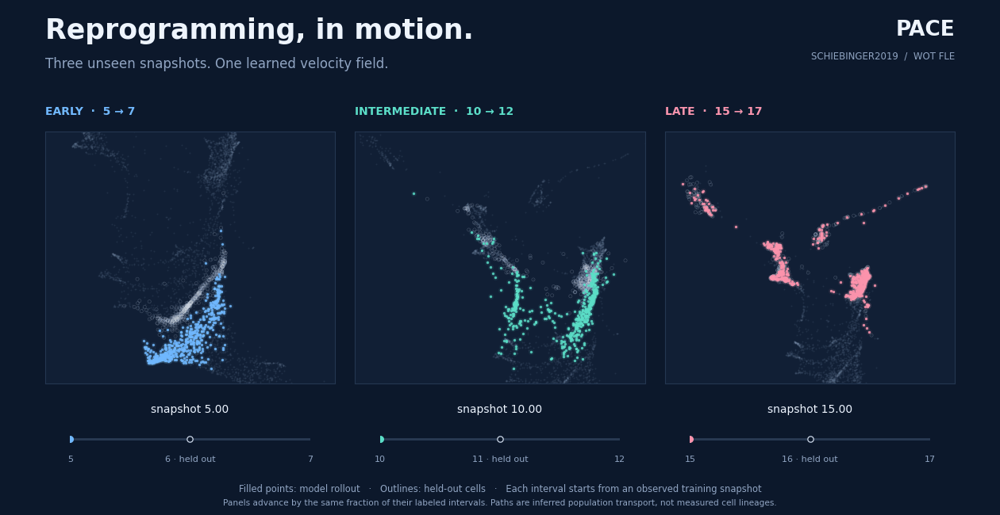
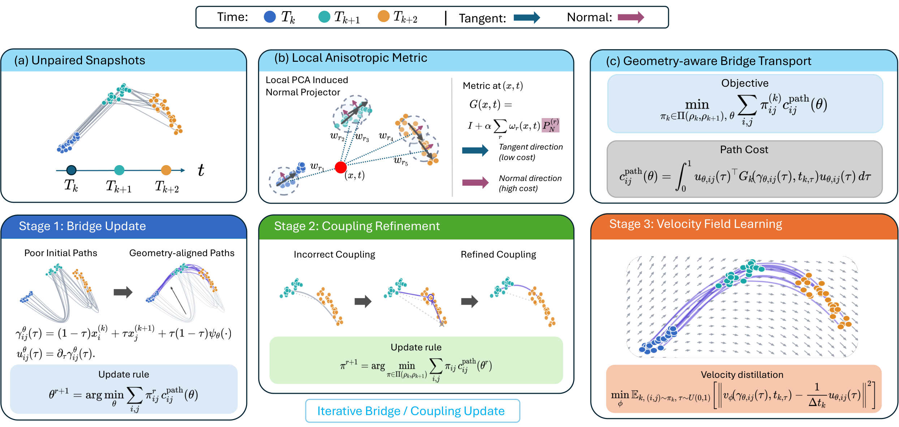

<div align="center">
  
  <h3>Geometry-Aware Bridge Transport<br>for Single-Cell Trajectory Inference</h3>
  <p>From unpaired snapshots to continuous cell-state dynamics.</p>
  <p>
    <a href="https://arxiv.org/abs/2605.18587"></a>
    <a href="LICENSE"></a>
    <a href="notebooks/01_data_tour.ipynb"></a>
  </p>
  <p><a href="#quick-start">Quick start</a> · <a href="#learn-by-doing">Notebooks</a> · <a href="docs/experiments.md">Experiments</a> · <a href="data/README.md">Data</a> · <a href="#citation">Citation</a></p>
</div>

<p align="center">
  
  <br><sub>WOT reprogramming: three observed-anchor reconstructions, with snapshots 6, 11 and 16 held out. <a href="docs/development-demo.md">Reproduce the animation</a> · <a href="assets/reprogramming-demo-provenance.json">Run provenance</a>.</sub>
</p>

PACE learns continuous transport between destructive time-course snapshots.
It estimates local tangent geometry, alternates neural bridge learning with
geometry-aware coupling updates, then distills the bridges into a velocity
field that can be integrated as an ODE.

This repository includes **PACE** (called `imfm` in the development code) and
**Metric Flow Matching (MFM)**, along with the inputs for all **seven paper
datasets**, experiment configurations, and executable tutorials. Other methods
compared in the paper are outside this release's implementation scope.

> **Reproducibility status.** The release follows the representations and splits
> in [the paper](https://arxiv.org/html/2605.18587v2). Current development runs are
> not all identical to the published tables. See the concrete differences and
> validation scope in [the reproduction notes](docs/reproducibility.md).

## How PACE works

<p align="center"></p>

1. **Estimate geometry.** Local PCA identifies tangent and normal subspaces;
   the metric penalizes motion in normal directions.
2. **Learn bridges and couplings.** Endpoint-preserving neural paths and OT
   assignments are refined under the same geometry-aware path cost.
3. **Distill dynamics.** A time-conditioned vector field learns the bridge
   velocities, yielding a continuous population-level model.

See [the paper-to-code guide](docs/method.md) for the equations, implementation
locations, and the distinction between PACE and the MFM baseline.

## Quick start

Use Python **3.11** in a fresh environment. Run commands from the repository root.
All seven benchmark inputs are included; no dataset download is needed.

```bash
git clone https://github.com/AI4Science-WestlakeU/PACE.git
cd PACE
python3.11 -m venv .venv
source .venv/bin/activate
python -m pip install -r requirements.txt

# Small end-to-end CPU run: bridge learning → velocity training → evaluation
python train.py experiment=oceans_positions_pace_ode trainer=cpu \
  total_epochs_stage1=3 rematch_every=1 epochs=2 \
  samples_per_timepoint=24 batch_size=24 stage1_batch_size=24 \
  T_steps=3 t_probe_steps=3 enable_progress_bar=false \
  working_dir=results/tutorial
```

The short run checks the pipeline; it is not intended to produce converged results.
For the full configured experiment on a CUDA GPU:

```bash
python train.py experiment=oceans_positions_pace_ode
python train.py experiment=oceans_positions_mfm_ode

# EB PHATE, with snapshot 3 held out
python train.py experiment=eb_phate_pace_ode
```

Use `trainer=cpu` when CUDA is unavailable. Choose a PyTorch installation
compatible with your CUDA environment before installing the requirements.

To train the README reprogramming demonstration, use
`python train.py experiment=wot_fle_reprogramming_demo`. Its configuration,
rendering command, and an optional embryoid-body example are documented in
[the biological demo notes](docs/development-demo.md).

## Learn by doing

| Notebook | What you will do |
| --- | --- |
| [01 · Explore the data](notebooks/01_data_tour.ipynb) | Inspect all seven datasets, visualize time labels, understand training/holdout splits. |
| [02 · Train PACE and MFM](notebooks/02_train_and_compare.ipynb) | Run a small CPU experiment for each method and compare saved metrics and trajectories. |
| [03 · Query a learned flow](notebooks/03_inference_and_results.ipynb) | Load a checkpoint, integrate its velocity field, and inspect held-out reconstruction. |

```bash
python -m pip install -r requirements-dev.txt
jupyter lab notebooks/
```

## Experiments at a glance

| Dataset | Representation | Held-out labels | PACE experiment |
| --- | --- | --- | --- |
| Ocean | 2D positions | 1, 3, 5, 7 | `oceans_positions_pace_ode` |
| Two-Branch | 2D positions | 1, 4 | `toy_bifurcation_pace_ode` |
| EB PHATE | 2D PHATE | 3 | `eb_phate_pace_ode` |
| Schiebinger2019 | 2D FLE | 6, 11, 16 | `wot_fle_three_interpolation_pace_ode` |
| iPSC-Liu | 2D PCA | 4, 16  | `ipsc_liu_pace_ode` |
| iPSC-Liu | 10D / 50D PCA | 4, 8, 12, 16 | `ipsc_liu_pace_ode_{10,50}d_test{t}` |
| OP-Cite | 100D PCA | 3 | `op_cite_pace_ode_100d` |
| OP-Multi | 100D PCA | 3 | `op_multi_pace_ode_100d` |

Replace `pace` with `mfm` for the baseline. Names containing braces are templates;
substitute one dimension and one label. The 10D and 50D iPSC settings each
aggregate four runs, giving nine benchmark settings in total.

```bash
# Print the 30 commands covering both methods and the paper's splits
python scripts/run_paper.py
# Execute the PACE suite (substantial training workload)
python scripts/run_paper.py --method pace --run
# Inspect a resolved configuration without training
python train.py experiment=op_multi_pace_ode_100d --cfg job --resolve
```

Additional dimensional variants, WOT forecasting, and five PACE ablations are
indexed in [the experiment guide](docs/experiments.md).

## Outputs and evaluation

Each run writes to `results/<dataset>_dim<D>_test<labels>/<method>/` under
`working_dir`:

- `resolved_config.yaml`: the actual configuration used for this run.
- `checkpoints/stage1_psi/` (PACE) or `checkpoints/stage1_geopath/` (MFM), and
  `checkpoints/stage2_flow/`: model checkpoints.
- `metrics/distribution_metrics.csv`: MMD, W1, W2, and GW diagnostics.
- `plots/`: bridge and ODE-rollout visualizations for 2D experiments.

For paper-style held-out reconstruction, select rows with `stage=stage2` and
`predictor=ode_rollout`. This starts from the observed training snapshot before
each holdout; a rollout from the first timepoint is a different diagnostic.
RNA/simulator velocities are used only for evaluation:

```bash
python scripts/eval_holdout_velocity_metrics.py results/eb_phate_dim2_test3
python scripts/eval_holdout_velocity_metrics.py results/oceans_positions_dim2_test1-3-5-7
```

## Repository map

```text
configs_hydra/   data, method, model, experiment, and ablation configurations
data/           seven benchmark inputs, checksums, and source notes
src/methods/    pace/ and mfm/
src/dataloaders/ shared sampling and training-only standardization
src/plot/       bridge and rollout visualizations
notebooks/      three guided tutorials
scripts/        experiment suite, validation, data export, and demo rendering
docs/           method mapping, experiments, and reproducibility notes
assets/         logo, paper figure, and reproducible animations
```

## Citation

Chenglei Yu and Chuanrui Wang contributed equally.

```bibtex
@article{yu2026pace,
  title={PACE: Geometry-Aware Bridge Transport for Single-Cell Trajectory Inference},
  author={Yu, Chenglei and Wang, Chuanrui and Liao, Bangyan and Wu, Tailin},
  journal={arXiv preprint arXiv:2605.18587},
  year={2026}
}
```

The MFM baseline is adapted from [Metric Flow Matching](https://github.com/kkapusniak/metric-flow-matching)
(Kapusniak et al., NeurIPS 2024). Please also cite it when using that baseline.
Code is released under [MIT](LICENSE); see [third-party notices](THIRD_PARTY_NOTICES.md)
and [dataset provenance](data/README.md) for upstream attribution and data terms.
