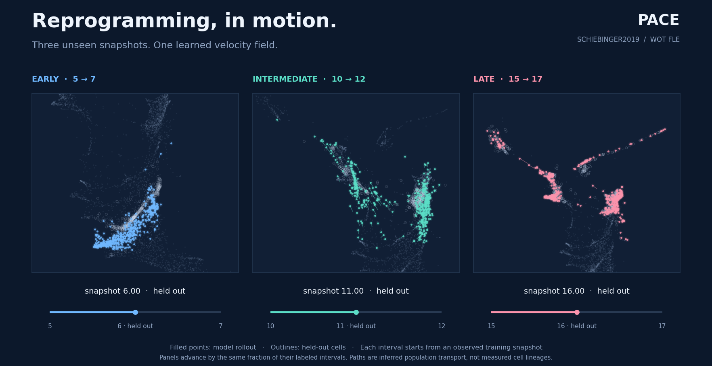
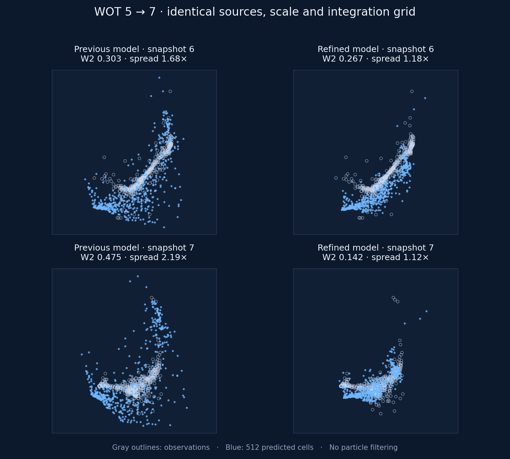

# Biological trajectory demonstrations

The README now shows **Schiebinger2019 / WOT reprogramming** in its provided 2D
FLE embedding. Three panels show the same PACE velocity model at early,
intermediate and late intervals. Each starts from an observed training snapshot:
**5→7**, **10→12**, and **15→17**. The middle snapshots **6, 11, 16** are held out.



## What the animation represents

Bright particles follow the trained velocity field; faint outlines show the
held-out cells for reference. All selected source cells are integrated and
shown, without selecting trajectories by their reconstruction error. The
background is a seeded sample of the observed embedding.

Each panel advances by the same fraction of its labeled interval, **not the same
absolute biological time**. There are no resets within an interval. The panels
are separate observed-anchor reconstructions, following the paper's evaluation
setup; this is not a single trajectory across all 19 snapshots. The labels are
the dataset's snapshot indices. These are inferred population-level paths in an
embedding, not measured individual cell lineages or assigned cell types.

## Training and reproduction

The current model was selected from two fresh two-stage H800 runs after feedback
about dispersion in the 5→7 interval. It uses seed 42, **80 bridge epochs**,
**1,000 velocity epochs**, noise **sigma=0.02**, and
**hungarian matching**. Stage 1 minibatches contain 128 cells.
The 512 cells per timepoint, original train/holdout split and training-only
standardization are unchanged. The paper preset is preserved; the separate
demo preset records these choices.

Model selection used holdout feedback, so this is a tuned README demonstration,
not an unbiased test or a reproduction of the paper's numerical tables. Both
candidate runs and the previous model are recorded in the
[complete refinement history](reprogramming-refinement.json).

```bash
python train.py experiment=wot_fle_reprogramming_demo
python scripts/render_reprogramming_demo.py results/reprogramming_demo/results/wot_fle_three_interpolation_dim2_test6-11-16/pace --selection-note "Demo configuration selected using holdout feedback; see docs/reprogramming-refinement.json."
python scripts/evaluate_reprogramming_demo.py results/reprogramming_demo/results/wot_fle_three_interpolation_dim2_test6-11-16/pace
```

- [Compact experiment preset](../configs_hydra/experiment/wot_fle_reprogramming_demo.yaml)
- [Complete resolved configuration](../assets/reprogramming-demo-config.yaml)
- [Checkpoint/data hashes and rendering protocol](../assets/reprogramming-demo-provenance.json)
- [Training environment and source hashes](development-demo-training.json)
- [Input data and source notes](../data/README.md)

The renderer recreates the original scaler from the seeded training samples.
It uses 201 Euler grid points per interval and stores the actual predictions in
`metrics/readme_reprogramming_rollouts.npz`. Fixed panel limits include all
predicted coordinates; no trajectory alignment, time warping, smoothing or
replacement by ground truth is performed. Each panel has its own local view.

## Diagnostic checks

These values come from the exact 201-point trajectories used by the animation,
in standardized FLE coordinates. The training evaluator separately saves its
usual 101-point bracket metrics. Neither table is claimed to reproduce the
published scores exactly.

| Interval | Held-out snapshot | Held-out W2 ↓ | Held-out MMD ↓ | Endpoint W2 ↓ |
| --- | ---: | ---: | ---: | ---: |
| 5 → 7 | 6 | 0.2672 | 0.4119 | 0.1421 |
| 10 → 12 | 11 | 0.2167 | 0.1790 | 0.4046 |
| 15 → 17 | 16 | 0.3911 | 0.0733 | 0.4848 |

All three held-out W2 values improve relative to the previous model. Held-out
snapshot 11 MMD slightly increases (0.1716→0.1790); the change does not improve
every metric.

For the requested **5→7** interval, using identical cells and integration grids:

| Snapshot | W2, previous → current | Spread ratio, previous → current | P95 nearest-observation distance, previous → current |
| --- | ---: | ---: | ---: |
| 6 | 0.3035 → 0.2672 | 1.68× → 1.18× | 0.2612 → 0.1887 |
| 7 | 0.4746 → 0.1421 | 2.19× → 1.12× | 0.3130 → 0.1664 |

Spread ratio is the RMS radius of the predicted cloud divided by that of the
observed cloud (1 means equal global spread). P95 distance measures the upper
tail of each predicted cell's distance to its nearest observation. These are
complementary diagnostics, not substitutes for a full distribution comparison.



The final checkpoint was loaded strictly on local CPU; all trajectories are
finite. The selected training process exited successfully after
396 seconds. No cells were removed to improve the display.

## Embryoid-body example

A second fresh run uses the unchanged `eb_phate_pace_ode` preset: seed 42,
120 bridge epochs, 350 flow epochs, and 1024 cells per snapshot. An optional
animation covers the observed bracket **2→4**, crossing held-out snapshot **3**.
Its 401-point rollout gives W2 0.3056
and MMD 0.0929 at snapshot 3.

```bash
python train.py experiment=eb_phate_pace_ode seed=42 enable_progress_bar=false working_dir=results/eb_development_demo
python scripts/render_development_demo.py results/eb_development_demo/results/eb_phate_dim2_test3/pace
```

[EB animation](../assets/eb-development.gif) ·
[EB complete config](../assets/eb-development-config.yaml) ·
[EB provenance](../assets/eb-development-provenance.json)

The EB model was also checked with continuous integration from snapshot 0;
that longer rollout accumulated substantial drift (snapshot-3 W2 2.3311), so it
is not presented as successful end-to-end development. Restricting the displayed
interval changes the inference starting condition, not the trained weights or
held-out split.

The earlier [Ocean demo and tuning history](ocean-demo-tuning.md) are retained as
an archived example and no longer appear in the README hero.
