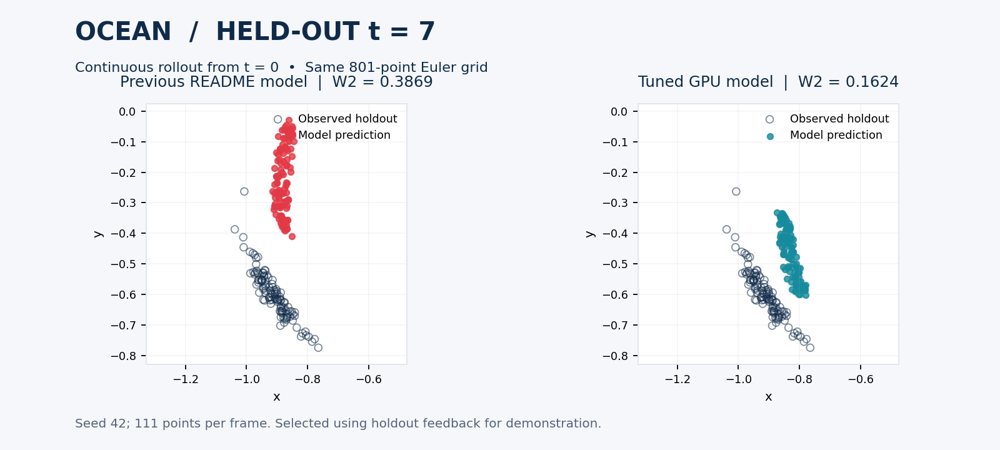

# Ocean demonstration: archived tuning record

The README now uses the [WOT reprogramming demonstration](development-demo.md).
This page preserves the earlier Ocean example and its complete tuning history.

The updated animation uses a PACE model trained on an NVIDIA H800 with
`seed=42`, `sigma=0.2` and **300 flow epochs**. The bridge still uses the original
60-epoch configuration. Relative to the previous CPU-trained README model,
continuous-rollout W2 at **t=7 falls from 0.3869 to 0.1624
(58.0% lower)**. Mean W2 over all four held-out
frames falls from 0.1837 to 0.1030 (43.9% lower).

This is a **demonstration selected using holdout feedback**, including the user's
request to improve t=7. We tried 22 configurations with one seed; these are not
unbiased test results, multi-seed estimates, or replacements for the paper tables.
The original paper-suite preset is unchanged, and the demo is excluded from
`run_paper.py`. The first held-out frame, t=1, is worse in the selected model;
t=3, t=5 and t=7 improve. There is still visible displacement at t=7.



## Protocol and data

- All 111 points per snapshot. Train on labels **0, 2, 4, 6, 8**; hold out **1, 3, 5, 7**.
- No held-out positions or reference velocities enter a training loss. Holdout
  metrics were used to choose the demonstration hyperparameters.
- Every trial trains both stages from scratch. No Stage 1 checkpoint is reused,
  because the inherited checkpoint format omits the final coupling state.
- Animation evaluation: one continuous **801-point Euler** rollout from label 0
  to label 8, with model time equal to `label / 8`. It never resets to later
  observed snapshots. The old and new models use this identical grid.
- Paper-style reconstruction: a separate **101-point Euler** rollout from each
  preceding observed training frame to the next, scored at its midpoint.
- No trajectory smoothing, time warping, post-hoc alignment, particle removal,
  or ground-truth replacement is used to make the new result look better.
- The new GIF displays original time labels and pauses at t=7. Its frame density
  changed from the original 121-point rendering to 801 integration points;
  the numerical before/after comparison above reevaluates both models at 801.

## Continuous-rollout W2 (lower is better)

The GPU control repeats the old training parameters on the new hardware. It
separates the effect of switching the training environment from the subsequent
parameter search. The selected model improves t=7 by
34.6% relative to that control.

| Label | Previous README (CPU) | Original settings (GPU) | Selected demo (GPU) |
| --- | ---: | ---: | ---: |
| 1 | 0.0692 | 0.0525 | 0.1143 |
| 3 | 0.1377 | 0.0967 | 0.0636 |
| 5 | 0.1410 | 0.0879 | 0.0719 |
| 7 | 0.3869 | 0.2482 | 0.1624 |
| Mean (1/3/5/7) | 0.1837 | 0.1213 | 0.1030 |
| 8 (observed endpoint) | 0.1895 | 0.0542 | 0.1047 |

## Bracketed-rollout W2 (a different task)

These predictions restart from the preceding observed training frame. They are
not the continuous trajectories shown in the animation. The selected model has
higher mean bracketed error than the previous README model; selection prioritized
the continuous trajectory, especially t=7.

| Held-out label | Previous README (CPU) | Original settings (GPU) | Selected demo (GPU) |
| --- | ---: | ---: | ---: |
| 1 | 0.0685 | 0.0517 | 0.1140 |
| 3 | 0.0504 | 0.0491 | 0.0485 |
| 5 | 0.0404 | 0.0397 | 0.0443 |
| 7 | 0.1055 | 0.0769 | 0.0963 |

## Reproduce and inspect

The compact preset is
[`oceans_positions_pace_demo.yaml`](../configs_hydra/experiment/oceans_positions_pace_demo.yaml).
Only `sigma` (0.1 → 0.2) and `epochs` (100 → 300) change the training settings
relative to the original preset. Seed, architecture, Stage 1 settings and split
stay fixed. Output location and descriptive metadata are separate.

```bash
python train.py experiment=oceans_positions_pace_demo
python scripts/evaluate_ocean_demo.py results/ocean_demo/results/oceans_positions_dim2_test1-3-5-7/pace
python scripts/render_demo.py results/ocean_demo/results/oceans_positions_dim2_test1-3-5-7/pace \
  --selection-note "Holdout-tuned README demonstration; not a paper-table reproduction."
```

The evaluator writes `metrics/ocean_demo_metrics.json` and the actual predicted
coordinates in `metrics/ocean_demo_predictions.npz`. A complete portable config
is also saved at [`assets/ocean-demo-config.yaml`](../assets/ocean-demo-config.yaml).
Checkpoint and data hashes are recorded in
[`assets/demo-provenance.json`](../assets/demo-provenance.json).

Training environment: Linux, Python 3.11.13, NVIDIA H800, CUDA 12.6,
PyTorch 2.7.1, Lightning 1.9.5,
POT 0.9.5. Different numerical libraries or accelerators can
produce different optimization trajectories even with the same seed.
The selected checkpoint was reevaluated on local CPU for the figure and GIF.

## All attempted configurations

All 22 trials completed both training and evaluation. No unsuccessful configuration
was removed from this record. Longer training, reduced noise, and stronger bridge
penalties did not consistently improve continuous trajectories. A final small
search around the higher-noise setting did not produce a better overall candidate.
The selected `noise020` run has the lowest t=7 and mean continuous W2 among these
trials. Exact commands, complete metrics, source hashes and environment versions
are in [`ocean-demo-sweep.json`](ocean-demo-sweep.json).

| Trial | Continuous t=7 W2 | Mean continuous holdout W2 | Bracketed t=7 W2 |
| --- | ---: | ---: | ---: |
| `noise020` | 0.1624 | 0.1030 | 0.0963 |
| `noise012_250` | 0.2078 | 0.1198 | 0.1026 |
| `noise015` | 0.2086 | 0.1327 | 0.1150 |
| `moderate200` | 0.2153 | 0.1265 | 0.1026 |
| `noise015_200` | 0.2480 | 0.1562 | 0.0712 |
| `gpu_control` | 0.2482 | 0.1213 | 0.0769 |
| `tanh_flow` | 0.2503 | 0.1426 | 0.2178 |
| `moderate150` | 0.2687 | 0.1303 | 0.0757 |
| `short75` | 0.2727 | 0.1236 | 0.1004 |
| `tanh150` | 0.2821 | 0.1597 | 0.0715 |
| `silu_flow` | 0.2950 | 0.1550 | 0.1531 |
| `tanh_moderate` | 0.2994 | 0.1567 | 0.1101 |
| `long_flow` | 0.3155 | 0.1475 | 0.2116 |
| `align30_metric1` | 0.3220 | 0.1501 | 0.0619 |
| `noise018_200` | 0.3222 | 0.1956 | 0.0629 |
| `align100` | 0.3295 | 0.1347 | 0.1214 |
| `low_noise` | 0.3789 | 0.1815 | 0.1209 |
| `noise020_150` | 0.3889 | 0.2317 | 0.0355 |
| `align30` | 0.4267 | 0.1817 | 0.1576 |
| `zero_noise` | 0.4369 | 0.2183 | 0.1627 |
| `smooth_bridge` | 0.7544 | 0.3420 | 0.1185 |
| `exact_bridge` | 1.7082 | 0.5459 | 0.2470 |
